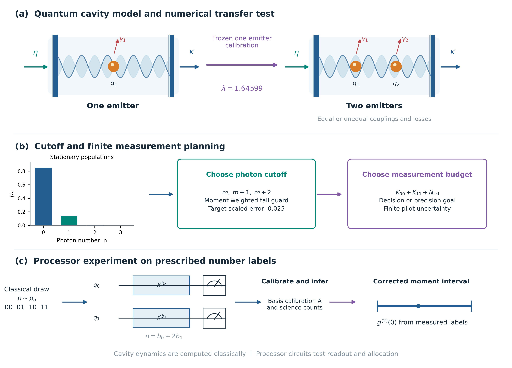

# Photon cutoff selection and measurement planning for quantum cavity correlations

Code, numerical data, and figures for the study by **Mohammad Javani, Clark Atlanta University**.

The study tests an empirically calibrated photon-cutoff score across one- and two-emitter cavity configurations. It compares observation budgets for estimating the second-order correlation and deciding whether that correlation is below one, including finite readout-calibration and pilot uncertainty.

| Recorded comparison | Result |
| --- | --- |
| Frozen one-emitter holdout | 64 of 64 cases meet the cutoff-error budget |
| Initial two-emitter transfer | 238 of 240 cases meet the budget |
| Revised guard on new structured cases | 192 of 192 cases meet the budget |
| Independent numerical audit | 225 primary checks pass |
| Precision-to-decision shot ratio | Median 12.59 among 36 jointly feasible cases |
| Completed processor pilot | 304,128 acquired observations per arm in one paired experiment |

The cutoff rule is empirical within the tested cavity families. The revised guard was designed after examining the two initial transfer failures and then tested on fresh structured cases. Both allocations passed the signal/control endpoint in the single completed processor pilot, leaving their relative success probability unresolved. The prospective repeated comparison remains uncollected.

## Verify the archive

Extract the package and open a terminal in the repository root. The integrity check uses the Python standard library.

~~~bash
python3 code/verify_package.py --hash-only
~~~

To recompute the numerical summaries, install the analysis and plotting dependencies.

~~~bash
python3 -m venv .venv
.venv/bin/python -m pip install -r requirements.txt
.venv/bin/python code/verify_package.py
~~~

If your installation is invoked as `python3.14`, use `python3.14 -m venv .venv` in the first line. The full packaging check was run with Python 3.12.14. Original calculation stages retain their dependency records inside `evidence/`.

Verification checks `SHA256SUMS.json`, recomputes the central numerical summaries, checks source fingerprints and evidence-archive hashes, and confirms that all twelve figures are available in PNG, PDF, and SVG. Its new report is written to `reproduced/validation_record.json`.

The manifest freezes the scientific inputs, figure-generation and verification code, supplied figures, and recorded results. Repository metadata such as this README and `CITATION.cff` can be customized separately.

## Regenerate the figures

~~~bash
.venv/bin/python code/make_figures.py
.venv/bin/python code/validate_results.py --output reproduced/rebuilt_validation.json
~~~

Figure generation reads the delivered numerical tables. Use a separate extracted copy when regenerating figures, since rendering metadata can differ across software versions.

The schematic uses circuit labels **q0** and **q1**, mapped to physical qubits **14** and **55** on `ibm_marrakesh`.

## Repository contents

| Location | Contents |
| --- | --- |
| `data/` | Per-case results, numerical figure inputs, pilot tables, processor counts, manifests, and prospective-validation summaries |
| `evidence/` | Original calculation code, result records, and analysis archives |
| `code/make_figures.py` | Figure generation from the delivered tables |
| `code/validate_results.py` | Numerical-summary, fingerprint, and figure checks |
| `code/verify_package.py` | Integrity and numerical-verification entry point |
| `figures/` | Twelve figures in PNG, PDF, and editable SVG |
| `validation_record.json` | Recorded numerical verification |
| `CITATION.cff` | Citation for this software and data package |

## Original calculation stages

Code for the initial cutoff-and-shots pilot, two-emitter follow-up, calibration/science allocation, finite-pilot planning, physics audit, and prospective replication planning is stored in the corresponding archives under `evidence/`. Extract a stage and follow its own README and dependency instructions.

The cavity dynamics are calculated classically. The processor records concern classically sampled number labels prepared with X gates, which test the readout-inference procedure.

## Upload to GitHub

Suggested repository name: `photon-blockade-cutoff-reproducibility`.

Upload the extracted contents so `README.md` is at the repository root. Include `.gitignore` and `.gitattributes`, which can be hidden in a file browser. The package contains fewer than 100 files, and each individual file is below 25 MiB.

Suggested commit message: `Add photon cutoff code, data, and figures`.

The package version is **1.0.1**. Citation details are in `CITATION.cff`.

